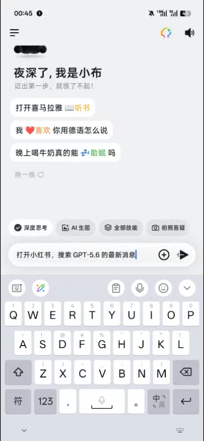
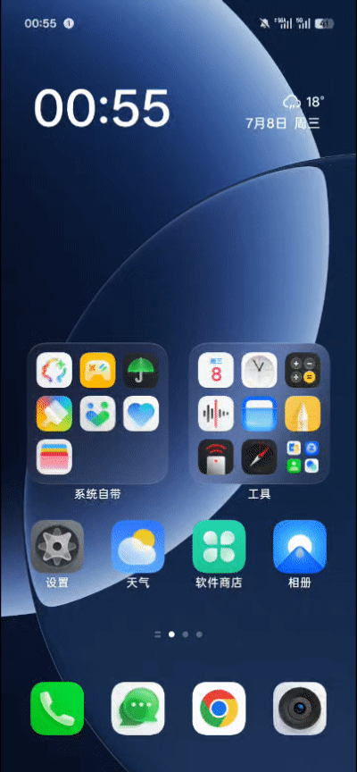
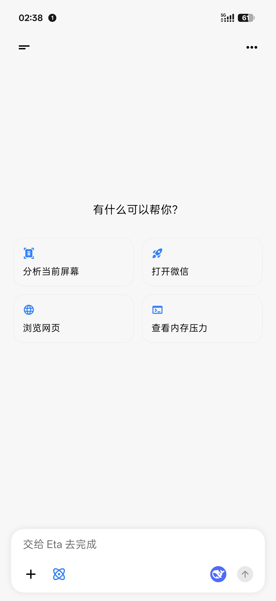
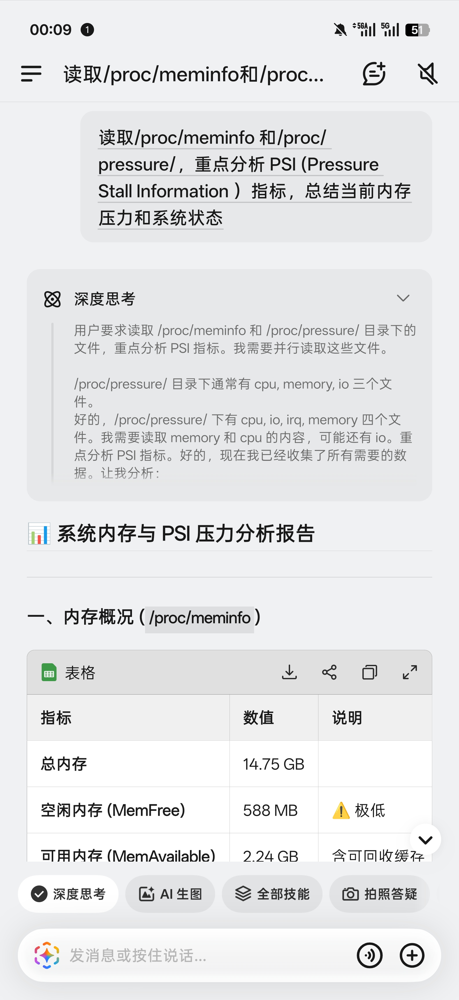
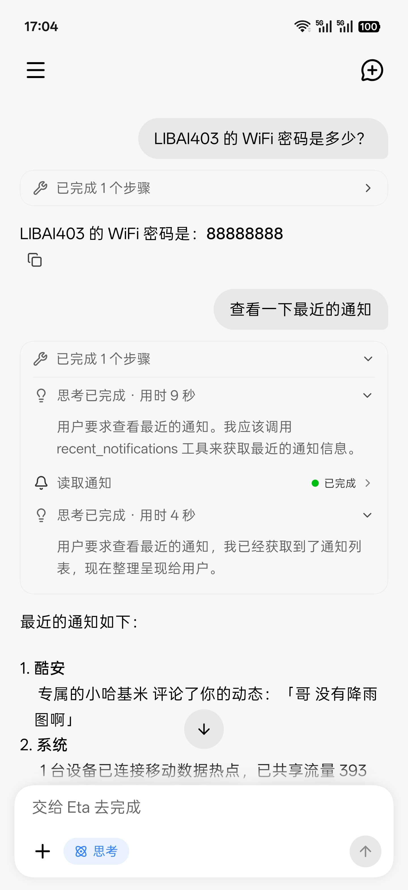
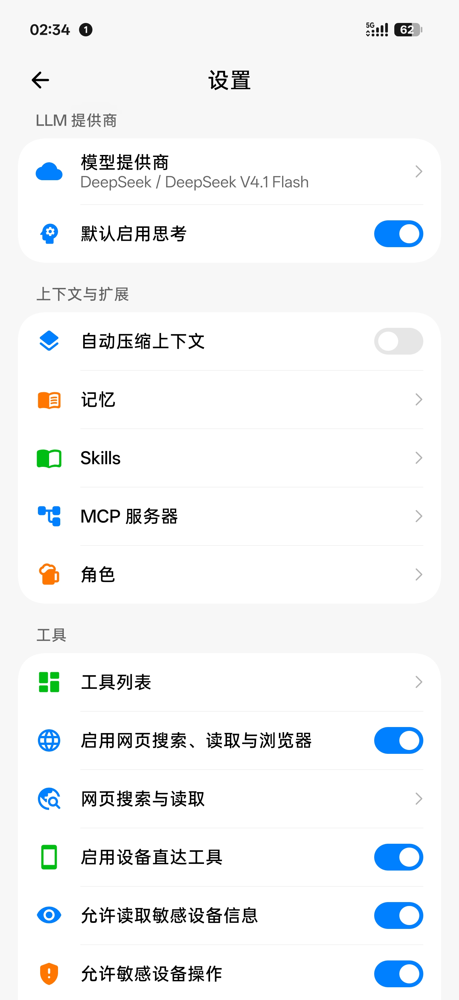
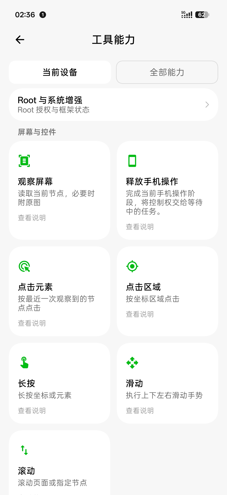

# Eta

[简体中文](README.md) | **English**

    

**A third-party, system-level AI assistant for Android**

Eta is an AI agent designed for phones and other mobile devices. It pairs the autonomous task planning and execution familiar from coding agents such as [Codex](https://openai.com/codex/) with the GUI-driven, cross-app interaction demonstrated by [Doubao Phone Assistant](https://o.doubao.com/). It can work with files, run commands, and write code. Integrations with Android and OEM apps also let it call system APIs directly and retrieve information from notifications, calendars, photos, and other local sources.

**System-level capabilities:**

- **System actions:** call Android APIs directly to set alarms, control media playback, adjust volume, and more.
- **OEM data:** query sources such as Xiaobu Memory, notes, and recording summaries on supported systems with the required permissions.
- **System entry points:** use Xposed hooks to route the power button and requests from Breeno (Xiaobu) or Super XiaoAI to Eta.

Eta has its own agent runtime. An agent loop coordinates model requests, tool execution, and feedback, with Skills and MCP available for extensions. **You must supply your own model-provider API key (BYOK)** to use its AI features; you choose the model and provider.

Requires **Android 13 or later**. The app works across phone brands, and core features do not require root. Root and LSPosed extend system access and assistant integration where permissions and ROM compatibility allow.

[Download APK](https://github.com/Mangi-11/Eta/releases) · [Getting started](#getting-started)

## See it in action

| GUI Agent | Breeno with your own model |
| :---: | :---: |
|  |  |

More screenshots: chat, system tools, and settings

| Chat | Commands through Breeno | Direct system API calls |
| :---: | :---: | :---: |
|  |  |  |

| Settings | Tools | Skills |
| :---: | :---: | :---: |
|  |  |  |

## Core capabilities

### Execution tools

- **System and first-party app actions:** call Android APIs and first-party app interfaces directly to read and write calendar events (single or batch creation, updates, and deletion), manage alarms and timers, and create or recycle system notes; control the flashlight, brightness, screen timeout, ringer and Do Not Disturb, Night Light and dark mode, volume, media playback, Wi‑Fi, Bluetooth, mobile data, personal hotspot, NFC, location, and battery saver. Eta can also inspect app versions, install sources, and permissions, force-stop or freeze apps, and filter system logs with root. Settings, toggles, and first-party app writes are read back to confirm the actual state rather than replayed blindly.
- **GUI Agent and background virtual display:** combine the accessibility UI tree, element targeting, and screenshots taken as needed to tap, long-press, swipe, scroll, and type text; successful actions include a snapshot of the new UI tree, and screenshots preserve their original size and pixels without pre-upload scaling or JPEG conversion. Eta automatically routes between the physical screen and a background virtual display: if the target app is already in the foreground on the main screen, Eta operates in place (with flowing edge light and a top status capsule that moves aside when gestures pass through); cross-app tasks run silently on a trusted background virtual display when root or LSPosed is available, suppressing background audio-focus theft so your main screen and media stay uninterrupted. While the virtual display is active, the top capsule embeds a live micro-lens; tap it to expand a framed stage card for live preview, direct touch takeover on the canvas, or one-tap fullscreen handoff, and the model can call `present_to_user` at checkout, QR-code, or result screens to move the running task seamlessly to the main display. When a text field on the virtual display takes focus, Eta temporarily switches to a headless input method so the keyboard never appears on your main screen, then restores the previous one when focus leaves; if the process is reclaimed during that window, the next launch repairs the default input method. On Android 16 QPR2 and later, run status also appears in the status bar chip and on the lock screen via Live Updates, which some systems map to Fluid Cloud and similar surfaces.
- **Web search and built-in browser:** search public web pages and read static content in pages without launching a browser, switching between the built-in default, DeepSeek Search / Fetch, or custom HTTP endpoints in Settings. Dynamic JavaScript pages load in an off-screen WebView for content extraction, DOM interaction, and screenshots, and you can open the same browser session to take control.
- **Terminal and files:** use Android `user`/`root` shells, Alpine or Debian Linux, file operations, image reading, and scripts, with support for persistent sessions, background commands that continue after a reply ends, and cross-run daemon tasks. Text reads continue on UTF-8 byte boundaries, edits check the old content first, and searches report the actual scope and any unfinished part; multi-edit and cross-file refactors commit in one go, roll back the already-written files if a cross-file write fails midway, and save a checkpoint before writing so `restore_file` can undo it, with `dry_run` to preview the diff only.
- **Environment variables:** add or remove `KEY=VALUE` entries under Settings → Environment variables; they are injected into the Agent's terminal commands, background jobs, and Linux session launches, with `/sdcard/Download/eta-env.conf` as a read-only override source.
- **Screen and power:** Settings → Chat and execution can turn on "keep the screen on while a session is running": while any session is running and not paused, the foreground window uses `FLAG_KEEP_SCREEN_ON`, and after you switch to another app an explicit wake lock keeps the device awake; pausing, finishing all sessions, or turning the switch off releases it immediately, and the power button still turns the screen off at any time. Browser previews stop polling once the page is static, and background jobs use a foreground service with wake locks on demand.
- **Message actions:** every message has an explicit entry (the "⋯" beside it) for copy, edit, regenerate, and delete. Very large conversations stay editable too: history is read back on demand when you start editing, so you don't have to start a new conversation.
- **Coding workflow:** AGENTS.md / CLAUDE.md / ETA.md / .eta/rules.md in the workspace are added to the system prompt; `project_info` detects the project type and suggests build, test, and check commands; existing files are read with `read_file` before editing, large changes are previewed with `dry_run`, a checkpoint is saved before writing, and afterwards `read_file` / `stat_file` plus the project's smallest test confirm the result.

A task can combine these tools: read web sources and then organize files with a script, or find order details in notifications and open the relevant app to check their status.

### Context and extensions

- **Personal context:** retrieve notifications, app usage, and location on demand. Dedicated searches for photos, calendar events, SMS messages, recordings, health summaries, and chat images require root; some sources also depend on the ROM and installed apps.
- **Long-term memory:** store context for future conversations in a local `MEMORY.md`. Core memory is included within a context budget, with the rest retrieved as needed. You can edit, clear, or disable it.
- **Skills:** load task instructions, reference material, and script resources as needed. Install from public GitHub repositories or import a local ZIP. Installation does not run scripts or grant additional permissions.
- **MCP:** connect remote tools over Streamable HTTP, with optional bearer-token authentication. Enable tools individually to use them alongside local tools.

### Agent runtime

The runtime runs inside Eta. Requests from chat and system assistants use the same agent loop: the model selects tools through tool calling, execution results return to its context, and it decides what to do next. Calls are validated against JSON Schema and permissions are checked before execution. Hooked processes only handle the entry point and return path.

The runtime also manages streaming events, steering, cancellation, and incremental transcripts. Steering messages enter after the current turn completes. Conversations and results are stored locally; after an interruption, Eta attempts to recover existing records without automatically replaying actions. When the process is reclaimed and you reopen the app, it explains why it stopped last time (low memory, system cleanup, or a start timeout), and your conversations are unaffected. See [Agent Runtime](docs/AGENT_RUNTIME.md) for implementation details.

## A terminal designed for mobile

You can use Eta's terminal yourself or let the agent use it. Each session retains its working directory and environment. The PTY console is the default view and runs TUIs such as Claude Code, Codex, and Kimi Code: input goes straight to the terminal, an extra-keys bar provides Esc, Ctrl/Alt, arrows, Enter, and paste, and the grid resizes with the soft keyboard. The compact view groups input and output by command. Asynchronous commands and daemon tasks have logs and explicit stop controls.

- **Linux environments:** choose Alpine or Debian. PRoot works without root; rooted devices can also use chroot. The backends have separate installations, with no automatic data migration. PRoot's simulated root identity does not grant Android system privileges.
- **Development tools:** install Python, Node.js, SSH, APK analysis tools, and Kimi Code as needed.
- **File management:** import and export files through the private workspace, share accessible Android directories under `/workspace/mounts/` in Linux, and browse Linux files from the app.

Eta itself can read projects, edit code, run commands, and verify results. For longer coding sessions on a phone, [Kimi Code](https://github.com/MoonshotAI/kimi-code)'s **Kimi Web** offers a web UI well suited to mobile. Continue a conversation, inspect code changes, and review execution results in your browser, with a full coding-agent workflow for vibe coding wherever you are.

After installing Linux, Node.js, and Kimi Code in Eta, launch Kimi Web from the home screen or run `kimi` in the terminal. Kimi has its own model configuration and sessions, so it requires a separate sign-in or setup. You can return to a running instance after leaving the page, or stop it from Eta.

## Models and BYOK

Eta's AI features require **your own model-provider API key**. Built-in provider configurations include OpenAI, Anthropic, Alibaba Cloud Model Studio, DeepSeek, Kimi, MiMo, MiniMax, StepFun, SiliconFlow, and OpenRouter. You can also add custom services.

The provider layer supports OpenAI-compatible Chat Completions, the Responses API, and Anthropic Messages, including SSE streaming, tool calling, image input, and reasoning content. Configure custom endpoints, headers, and request bodies; fetch model lists or add models manually; and override context windows and reasoning effort. Available features depend on the model and API. Some Responses providers also support server-side web search.

Automatic compaction needs the model's context window in tokens, set under Settings → Model Providers. When fetching models, windows reported by the provider are filled in automatically. Without it, chat still works and manual compaction remains available. Automatic context compaction is enabled by default under Settings → Context & Extensions; changes apply to the next run, and manual compaction remains available when disabled. Automatic compaction uses the provider's reported input usage and this configured window. Eta does not fill in missing windows or estimate request tokens; manual compaction remains available when input usage is absent.

## System assistant entry points

- **Power-button long press:** choose the default OEM assistant, Gemini, or Eta.
- **Eta system assistant:** open Eta's global voice overlay from the power button, where the glow enters along the screen edge from the key position and gathers at the bottom; you can also switch to the keyboard or tap a suggestion instead of speaking. The screenshot and app content at wake time are attached automatically, with no extra tap and no accessibility screenshot permission. Speech recognition uses the Qwen or Doubao online APIs (only microphone permission and the matching service configuration; no device recognizer required) and can be turned off in Settings to open the text composer and keyboard directly. Speech synthesis supports Qwen, Doubao, Gemini, and MiniMax with voice selection and preview, plus assistant auto-read, chat dictation, and manual/automatic read-aloud that keeps playing in the background or on the lock screen; pull up on the overlay to jump straight into the main Eta chat. See [Voice](docs/VOICE.md).
- **Breeno / Super XiaoAI integration:** keep the familiar OEM assistant entry point while routing requests to Eta and your configured model.

On ROMs that lock down the default assistant or power-button behavior, power-button routing and OEM assistant integration require LSPosed and a supported system.

## Unlocking Gemini and Circle to Search

- **Gemini:** enable system-assistant capabilities, including making the Google app a system app, voice input on the lock screen and while the screen is on, and support for keeping hotword detection working with the screen off.
- **Circle to Search:** enable the feature and trigger it with a long press on the navigation handle or a two-finger long press on the screen.

These features require LSPosed and a supported system. See [Technical Implementation](docs/TECHNICAL.md) for functionality and compatibility details.

## Permissions and data

System tools, sensitive reads, sensitive actions, terminal and file access, browsing, and memory have separate switches, currently enabled by default. The runtime rechecks permissions before execution. Revoked access or a lost connection does not overwrite your saved settings.

- **Model requests:** task-relevant conversation content, images, and tool results are sent to your configured provider. A local runtime does not imply local inference. Custom HTTP endpoints transmit API keys and request content without transport encryption.
- **Local records:** raw arguments and results from sensitive tools and MCP tools are excluded from persistent conversation history; model replies are still saved. Once notification access is granted, Eta retains up to 1,000 notifications for seven days. MCP authentication tokens are stored encrypted.
- **Conversations and backups:** copy or edit messages, delete a conversation from a selected turn onward, and regenerate replies. A single conversation can be exported as Markdown; conversations, model configurations, and memory can also be imported or exported in bulk. Backups contain API keys.
- **Execution limits:** tasks can be stopped or taken over. Background work remains subject to Android and OEM process management; restart tasks manually after a force-stop or reboot. System and app updates may also require hook adaptations.

## Getting started

1. Download the APK from [Releases](https://github.com/Mangi-11/Eta/releases). After installation, open **Model provider** in Settings, enter your API key, and select a model. Task execution requires tool calling; interpreting images also requires image input support.
2. Enable the tools and permissions you need. GUI control requires Eta's accessibility service. Notification access and usage access are granted separately; location tools require **Allow all the time**. The tools page shows what is available on your device.
3. Start a conversation. For Linux, install a distribution, base tools, and any development tools you need under **Linux tool environment**. For assistant integration, see [System assistant entry points](#system-assistant-entry-points).

- **Unrooted devices:** Android 13+ on ARM64 supports chat, web search and browsing, memory, Skills, MCP, the ordinary terminal, and a private workspace. Calendar read/write, GUI control, and notification/location/usage access need their respective permissions.
- **Rooted devices:** gain access to background virtual-display execution, protected system settings and toggles, app management, privileged files, deep system and OEM personal-data searches, native first-party app operations (alarms, notes, etc.), root shells, and chroot.
- **LSPosed with a compatible ROM:** adds background virtual-display execution, OEM assistant integration, system shortcuts, the in-process Xiaobu Memory query bridge, and Google feature enablement. Some features also require root.

Dedicated searches for contacts, SMS messages, and calendar events still require root. See [Device Support](docs/ROOTLESS_SUPPORT.md) for full requirements and validation coverage.

## Further reading

These implementation notes are currently in Chinese:

- [Device support and permissions](docs/ROOTLESS_SUPPORT.md): unrooted and rooted devices, the file workspace, and background execution.
- [Technical implementation](docs/TECHNICAL.md): system tools, data retrieval, browser, terminal, and system integration.
- [Agent Runtime](docs/AGENT_RUNTIME.md): the agent loop, providers, steering, transcripts, and result recovery.
- [HyperOS system entry points](docs/HYPEROS_SYSTEM_ENTRY.md): power-button and Circle to Search integration, requirements, and validation coverage.
- [Native terminal components](docs/TERMINAL_NATIVE.md): PTY and PRoot components, and rebuilding the bundled source.

## Pull Requests and Contributing

External pull requests are closed; only collaborator commits are accepted.

In the AI era, handling external PRs has become harder than before: among the many AI-generated PRs, model capabilities and contributor skill levels vary widely, making it easy for AI slop to slip in. Coupled with a tedious workflow—aligning on architecture, going back and forth in discussions, and still having to review the code and test it ourselves—it is exhausting and costs far more than implementing an issue internally with AI. It is easier to just write it ourselves.

For feature requests, bug reports, or contributions, feel free to share your ideas or **prompts** directly in [Issues](https://github.com/Mangi-11/Eta/issues) and issue comments so AI can read the context and implement them directly. Thank you for your understanding and support!

## References and acknowledgements

- [Pi Coding Agent](https://github.com/earendil-works/pi): the main reference for Eta's agent runtime, including the agent loop, tool calling, steering, and transcript state management.
- [DeepSeek Harness](https://github.com/deepseek-ai/deepseek-harness) (dsh): reference for several interaction and presentation designs, including transcript view modes (`transcriptView` / `stepGrouping`), work-collapse timing (`collapseTiming`), busy-send behaviour (`BusyEnterBehavior`), the first-token and decode-time measures (`decodeMs`), and the `working_directory` tool contract.
- [Claude Code](https://github.com/anthropics/claude-code): reference for file-tool behaviour, including Read-before-Edit and MultiEdit-style batch editing.
- [Codex](https://github.com/openai/codex): `apply_patch`-style cross-file batch editing, and the habit of confirming build commands before touching an unfamiliar repository.
- [OmniBot](https://github.com/omnimind-ai/OmniBot): a reference project for AI agents on Android.
- [libxposed API](https://github.com/libxposed/api): the modern Xposed API.
- [Miuix](https://github.com/compose-miuix-ui/miuix): the UI component library.

## License

Copyright © 2026 [蛮吉 (Mangi-11)](https://github.com/Mangi-11)

This project is open source under GPL-3.0; see [LICENSE](LICENSE) for details.

GPL-3.0 permits commercial use, modification, and redistribution, provided that distributed
versions are also released under GPL-3.0 with the copyright notice retained. If you build on
Eta, please also keep the references list above — without those upstream projects there would
be no Eta (this is a request, not a licence condition).

Community: <a href="https://linux.do">LINUX DO</a>
